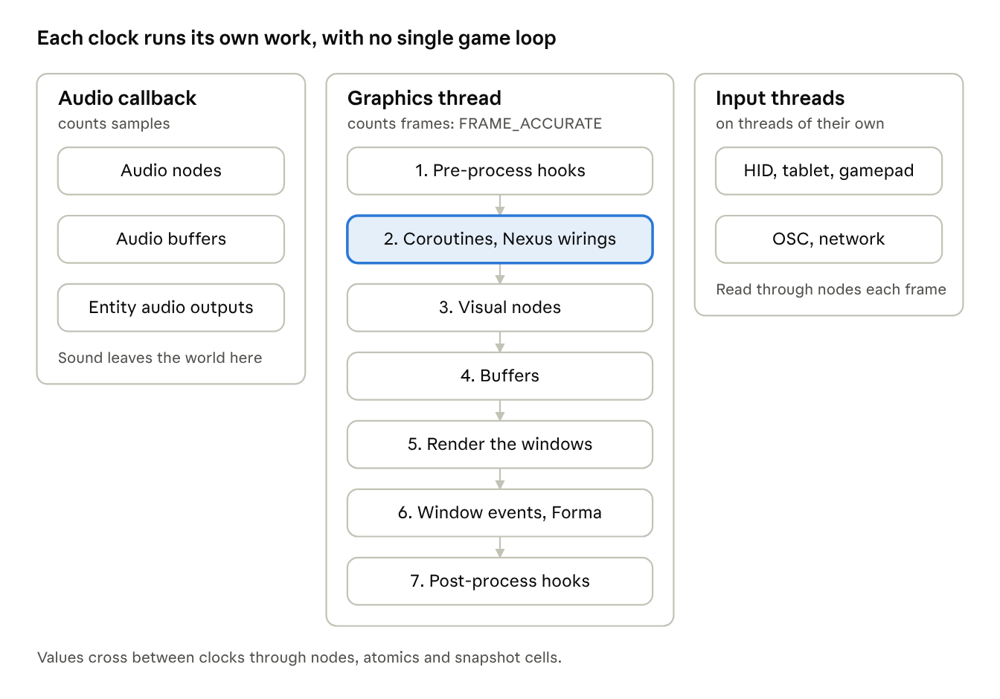
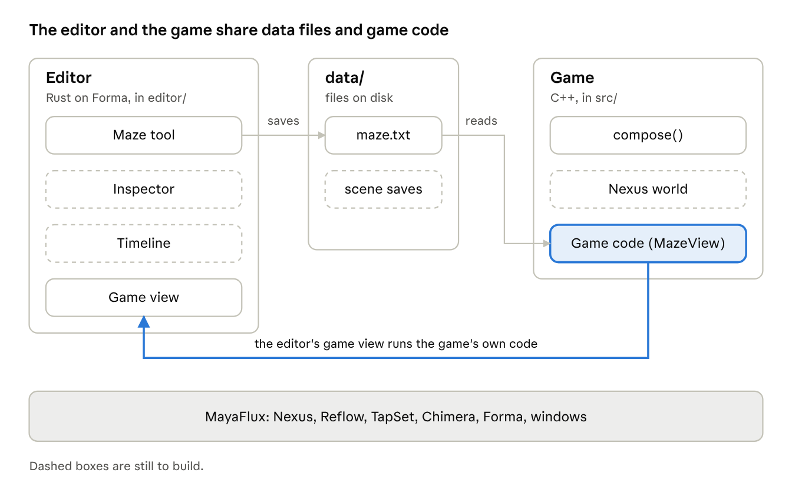

# MayaFlux for Unity developers

As of 23 Nov 2026.

If you know Unity, most of how our maze game is built will feel familiar. The differences are in where time comes from and how things in the world talk to each other.

This is not a feature checklist. It covers four things:

- the ideas Unity and MayaFlux share
- the ideas that are new in MayaFlux
- where timing comes from: clocks, schedules, events, node signals and recordings
- what MayaFlux already gives us, and what we build ourselves, as editor features or game features

It follows MayaFlux's develop branch as of 23 Nov, which now has skinning and cameras read from Alembic files ([pull request #196](https://github.com/MayaFlux/MayaFlux/pull/196)). Letting Nexus entities drive and follow animations comes in a later pull request.

## Ideas you already know

Most Unity ideas have a counterpart. The names differ, but the job is the same, so you can read a MayaFlux project with your Unity habits and adjust as you go.

| In Unity | In MayaFlux | What carries over |
| --- | --- | --- |
| Scene | A Nexus Fabric, held by a Tapestry | One place that holds the world. Nexus State saves and loads it as JSON. |
| GameObject and Transform | An entity: Agent, Emitter, Sensor, Presence or Locus | It has a position and an orientation, set with `set({ .position = ... })`. |
| MonoBehaviour | An Agent subclass, or influences and perceptions added to an entity | Your code lives on the object it belongs to. |
| `Update()` | `Kriya::each_cycle`, or a wiring: `every(FRAME_ACCURATE)`, a key, a mouse button, a network message | Your code runs again and again. You pick the clock it runs on. |
| Coroutines | Kriya coroutines, `schedule_sequence`, `EventChain` | Wait, then carry on. A coroutine resumes on the thread its clock runs on. |
| `Invoke`, `InvokeRepeating` | `Kriya::Timer`, `schedule_metro` | Call later, or call again and again. |
| `WaitForSeconds`, `WaitUntil` | `co_await` a delay or a `ConditionAwaiter`, `EventChain::when` | Wait for a time or for a condition. |
| UnityEvent, C# events | A `BroadcastSource<T>` heard with `on_signal` | One part announces, another listens. |
| Tweens | `schedule_line`, TimeMaps | Move a value over time along a curve. |
| Trigger collider, `OnTriggerEnter` | An Expanse with enter, exit and inside actions. A Hull takes its box from a mesh. | A region that reacts when something walks in. |
| `Physics.OverlapSphere`, `Raycast` | `within_radius`, `k_nearest`, `ray_cast` on the Fabric's snapshot | Ask what is near. Entities are points here, not shapes. |
| Camera | Locus, a Nexus Agent that drives the view of the things it draws. A camera from a file is a lens plus a placement, made into a view with `view_from_lens`. | A viewpoint that moves through the world. A file camera keeps its own lens and roll. |
| MeshFilter and MeshRenderer | A buffer (MeshBuffer, MeshNetworkBuffer) with a render processor aimed at a window | Geometry, plus how and where it is drawn. |
| SkinnedMeshRenderer | A skinned mesh in a MeshAssemblyRealization, bent on the GPU by its joints | The file's bones bend the mesh. |
| GPU instancing | InstanceNetwork | One mesh drawn many times. Our maze walls work this way. |
| Imported model, prefab hierarchy | MeshAssembly: parented rows, shared meshes, materials | A mesh used in many places is stored once. |
| Animation clip, Animator | A motion, played by a Reflow and its courses | Play, pause, seek, speed, loop, weight. Markers fire events, and `placement_blend` mixes the poses of several clips. |
| AudioSource | An entity's audio output. TapSet or a sampler for files. | Sound comes from an object in the world. |
| VideoPlayer | Chimera layers | A video plays into a texture. |
| Input System | Input nodes (HID, tablet, gamepad), window events, OSC | Read the device, map it to movement. |
| UI Toolkit, uGUI | Forma | The game's HUD and our editor's windows. |
| The Unity Editor | Our editor, written in Rust on Forma | The tool we make the game with. |

## New ideas in MayaFlux

These ideas have no direct Unity counterpart. They change how you set things up more than what you can make.

### There is no single game loop

Unity calls every `Update()` once a frame from one main thread. MayaFlux has several clocks instead. The audio callback counts samples, the graphics thread counts frames, and input devices run on threads of their own.

You say which clock each piece of code belongs to, for example `FRAME_ACCURATE` for the graphics frame. Nothing calls your code unless you wired it to something.

Code you would put in `Update()` goes in step 2, as a coroutine or a Nexus wiring. Forma's callbacks run in step 6.

### An entity perceives, then influences

When an entity fires, it first perceives: its neighbours from the spatial snapshot, or for a Locus, where its navigation has moved it. Then it influences the things it is tied to: an audio output, a shader parameter, a mesh's transform, a region's bounds.

In Unity you would look up components and set them each frame. Here you name the targets once, and the entity pushes to them every time it fires.

### Sound and picture are the same kind of thing

Audio, images, video, meshes and volumes are all data in containers, worked on by buffers. A node graph of oscillators, filters and envelopes can drive a camera, a colour or a mesh as easily as a speaker.

So "the sound changes the world" is not one audio system talking to a separate game system. It is one graph.

### Time is something you play

Any recorded thing plays through a Reflow with the same controls: a volume sequence, a point cloud, a mesh cache, a model's animation, a camera path. Speed (negative plays backwards), range, loop or ping-pong, seek, weight and markers work the same for all of them.

Animation is read from its keys at whatever time is asked for, so there is no bake step. A Reflow can also trail a recording by a lag, so echo and delay work on pictures and geometry, not only on sound.

### Every window is a peer

There is no main Game view or Scene view. The game can open as many windows as it likes, and each editor tool is its own window. Once rendering into an image lands, the game view can also sit inside an editor panel.

### Settings are plain values you can set from anywhere

Every entity, course and Reflow keeps its settings in a controls struct. It can be set from any thread and is listed by name. Our editor's inspector reads that list, and a Nexus influence writes to it when one part of the world steers another.

## Where time comes from

In Unity almost all timing comes from the frame: `Update()`, `Time.deltaTime` and coroutines that yield once a frame. In MayaFlux timing can come from a clock, a schedule, an event, a node's signal or a recording's position, and each one runs on the thread that owns it.

### Clocks

Every scheduled task names a processing token. The token picks the clock it counts in and the thread that resumes it.

| Token | Counts in | Resumed on | Task type |
| --- | --- | --- | --- |
| `SAMPLE_ACCURATE` (the default) | Audio samples | The audio callback | SoundRoutine |
| `FRAME_ACCURATE` | Graphics frames | The graphics thread | GraphicsRoutine |
| `MULTI_RATE` | Samples and frames at once | Whichever clock reaches its target first | CrossRoutine |
| `CONDITIONAL` | Wall-clock seconds, or until a condition holds | A worker thread. `add_worker` makes more. | FreeRoutine |
| `EVENT_DRIVEN` | Events, as they arrive | The thread that delivers the event | Event |

The default is the audio clock, so anything that touches graphics should ask for `FRAME_ACCURATE`. `seconds_to_samples`, `seconds_to_frames`, `samples_to_frames` and their inverses convert between clocks at the registered rates.

### Schedules you write down

These live in Kriya, with shortcuts in the top-level MayaFlux API. Each one takes a token, and named tasks can be stopped with `cancel_task(name)` or started again with `restart_task(name)`.

| Helper | What it does | Closest in Unity |
| --- | --- | --- |
| `schedule_metro(interval, fn)`, `Kriya::metro` | Calls `fn` every interval, counted in whole units of its clock | `InvokeRepeating` |
| `Kriya::each_cycle(fn)` | Calls `fn` once per unit of its clock, with no interval to round. Frame clock by default. | `Update()` |
| `schedule_sequence({{t, fn}, ...})`, `Kriya::sequence` | Runs each step after waiting `t` since the previous one, then ends | A chain of `Invoke` calls |
| `Kriya::Timer` | One callback after a delay. Scheduling again replaces it. | `Invoke` |
| `Kriya::TimedAction` | Runs a start function now and an end function after a duration | Start, then `Invoke` the stop |
| `Kriya::TemporalActivation` | Connects a node, network or buffer for a duration, then disconnects it | Play a sound for N seconds |
| `schedule_line(from, to, seconds)`, `Kriya::line` | Ramps a value. Read it with `get_line_value(name)`. | A tween |
| `schedule_pattern`, `Kriya::pattern` | Steps through values or a list. Gaps come from a list, a TimeMap or a function per pass, or a step runs whenever a condition holds. `on_complete` runs at the end. | A step sequencer coroutine |
| `Kriya::EventChain` | `then(fn, delay)`, `wait`, `every`, `repeat`, `times`, `forever`, `until`, `when(condition)`, `on(broadcast)`, `parallel` and `fork` lanes, `on_complete` | A scripted sequence, Timeline |
| Your own coroutine | `co_await` a `SampleDelay`, `FrameDelay`, `BufferDelay` (audio blocks), `MultiRateDelay`, `SteadyDelay` (wall clock) or `ConditionAwaiter` | `yield return WaitForSeconds`, `WaitUntil` |

Gaps, lags and speeds can follow a TimeMap instead of a fixed number. The presets are `linear`, `exponential`, `quadratic`, `triangle`, `lagged`, `integrated` (a velocity you change while it plays) and `piecewise_linear`. Patterns, courses, TapSet taps, Chimera layers and Reflow lanes all accept them.

### Events that arrive

An event handler runs on the thread that delivered the event, not on a main thread. If a handler needs the graphics thread, hand the value over through a node, an atomic or a broadcast that a frame task reads.

| Event | Helpers | Runs on |
| --- | --- | --- |
| Keys, mouse, scroll, text, resize, close | `on_key_pressed`, `on_key_released`, `on_any_key`, `on_mouse_pressed`, `on_mouse_drag`, `on_scroll`. Kriya adds `key_held` (repeats while held), `text_input`, `window_resized`, `window_closed` and `window_event(filter)`. | The thread that polls the window, step 6 of the frame |
| Network messages, OSC | `on_message_received`, for every message or filtered by sender, connection or a predicate | The network thread |
| Your own events | A `BroadcastSource<T>`, heard with `on_signal`, `on_signal_matching` or `co_await source->next()` | The thread that calls `signal()` |
| Each audio output cycle | `Kriya::audio_output_tick()` | The audio subsystem's notify thread |
| Each captured frame of a window | `Kriya::window_frame_tick(window)`, with the pixels | The capture readback thread |
| A value worked out every frame | `Kriya::frame_results(scheduler, fn)` turns `fn`'s results into a broadcast | Signalled from the graphics thread |
| Playback | `course->subscribe(...)`: Finished, Crossed, Repeated, Frame, Missed. `reflow->subscribe(...)`: Written, Held, Failed, Finished. | Where the Reflow runs, the frame clock once started |
| Nexus triggers | A wiring's `every`, `on(key)`, `on(mouse)`, `on(network)`, `on(broadcast)`, `on(window, filter)`, `on_scroll`, `move_to`, `times`, `for_duration`, `use(coroutine)` | The thread of its trigger |

A broadcast holds one waiting listener and one pending value. Give each consumer its own source. `EventChain::on` is the exception to the thread rule: it checks the source on the chain's own clock, so its action runs where the chain runs.

### Signals as clocks

Any node can be a clock. A counter that wraps, a gate that opens or a phase that comes round can start things, and the signal itself can be heard or drawn. A node's hooks run on the thread that processes it: the audio callback for an audio-rate node, the graphics thread (step 3) for a visual-rate node, the input thread for an input node.

| Node | Hooks | Good for |
| --- | --- | --- |
| Any node | `on_tick`, `on_tick_if(condition)` | Every value it makes, or only while a condition holds |
| Counter | `on_increment`, `on_wrap`, `on_count(n)`. A rising edge on another node resets it, and a negative step counts down. | Beats, bars, every Nth step, countdowns |
| Logic | `on_change`, `on_change_to(true or false)`, `while_true`, `while_false`. It can be a threshold, a hysteresis, an edge detector, AND, OR, XOR and the rest, or your own function over the current input, its history, time or several inputs. | Gates such as "close enough" or "loud enough", with hysteresis so they don't flicker |
| Phasor | `on_phase_wrap`, `on_threshold(value, rising)` | A loop with a cue at a set point in each cycle |
| Impulse | `on_impulse` | A pulse train |
| Filters | `on_tick`, `on_tick_if` | A smoothed value crossing a line |
| Input nodes | `on_threshold_rising`, `on_threshold_falling`, `on_range_enter`, `on_range_exit`, `while_in_range`, `on_value_change`, `on_button_press`, `on_button_release` | Any device value crossing a line or entering a range |
| HID, tablet, MIDI and OSC nodes | HID: `on_press`, `on_release`, `on_change`, `on_stick`, `on_hat`, `on_frame`. Tablet: `on_contact_begin`, `on_contact_end`, `on_proximity_enter`, `on_proximity_exit`, `on_frame`. MIDI: `on_note`, `on_cc`, `on_pitch_bend`. OSC: `on_message`. | Pen down, pen hovering, a stick past its dead zone, a note |
| GpuComputeNode | `on_complete` | A GPU job finishing |

A node can also gate a schedule without a hook. `Kriya::pattern` takes a condition such as `gate->get_last_output() > 0.5` and runs a step each time it holds, and `EventChain::when` waits on any condition.

### Recordings and pipelines as clocks

A recording's position is a clock too, and so is the cycle count of a buffer pipeline. Anything can read them and react.

| Source | Time it gives | What you can hook |
| --- | --- | --- |
| Reflow course | `time()` and `progress()` (0 to 1), readable from any thread | Course and Reflow events, and markers that fire as the playhead passes them in either direction. One course can follow another. Lanes can enter late (`enters_after`), show every Nth cycle (`every`), or trail a recording by a lag (`trailing_frames`). |
| TapSet tap | Its read position in a sound | Start time, speed, repeats and lag, fixed or as a TimeMap |
| Chimera layer | Its moment in a video ring or image collection | Start time, lag, speed, refresh every N frames, `cut`. The builder's `every(seconds, action)` runs an action alongside. |
| Sampler (SamplingPipeline) | Each voice's cursor in a sound | `play`, `play_continuous`, `trigger(voice, offset)`, `stop`, `build_for(ms)` |
| BufferPipeline | Its cycle count: audio blocks with `execute_buffer_rate`, frames with `execute_frame_rate`, or a set pace with `execute_scheduled_at_rate` | `every_n_cycles(n)` per operation, `branch_if(cycle test)`, `with_lifecycle(start, end)`, `on_complete` |
| Buffer capture | What it has collected: one cycle, N cycles accumulated, overlapping windows, a circular history, or until a condition | `on_data_ready`, `on_cycle_complete`, `on_data_expired` |
| `Kriya::record`, `record_into` | Live input written into a stream for N audio cycles | The pipeline's `on_complete` |

### How the game plans to use them

This is a plan, and none of it is built yet. Each game need has a time source that fits it, so very little ends up in a per-frame update.

| Game need | Time source |
| --- | --- |
| Player movement and the camera, every frame | `each_cycle`, or a Nexus wiring `every(FRAME_ACCURATE)`, reading the tablet nodes |
| Pen down, pen lifted, pen hovering | Tablet node `on_contact_begin`, `on_contact_end`, `on_proximity_enter`, `on_proximity_exit` |
| Walking into and out of rooms | Expanse enter and exit actions, checked by a commit metro |
| Music changing with the room | An EventChain: fade out, wait, switch taps, fade in |
| The world pulsing with the sound | A Phasor or Counter on the audio clock. Its `on_wrap` sets a value that the frame reads to flash a light or open a door. |
| Sensors over OSC | `on_message_received` or an OSC node, then a Logic node with hysteresis for a clean on and off |
| Tunnel video that follows the player | A Chimera layer whose lag is an `integrated` TimeMap, with the player setting its velocity |
| Camera paths | A Reflow course. Its Finished event hands control back to the tablet. |
| The editor's timeline | The same course's `seek` and `progress()`, set and read from the editor |

Audio-rate hooks run on the audio thread, so they set a value and let a frame task act on it. They never touch graphics directly.

## What MayaFlux already gives us

MayaFlux has a player for every kind of asset we plan to use, skinned characters included. Audio, images and video play in the current nightly. The rest is on MayaFlux's develop branch and arrives with the next nightly.

| Asset | Plays through | What you control | Available |
| --- | --- | --- | --- |
| Audio files, like our tunnel tracks | TapSet, or a sampler | Several taps on one file, each with its own start, speed, direction, level and channel. Repeats and stutters. | Now |
| Live sound | A ring, recorded with `record_into` | Taps that trail the live input by a lag, which can move | Now |
| Video files, like `tunnels.mp4` | Chimera, fed by `capture_to_stream` | Layers at different lags or speeds, cut to another moment, combined by a shader | Now |
| Stills and numbered image sequences | Chimera, with the images loaded into a TextureCollection | The same layer controls as video | Now |
| Volume sequences (VDB) | Reflow | Speed, range, loop, seek, weight | Next nightly |
| Point clouds and curves (Alembic) | Reflow | The same | Next nightly |
| Meshes that change over time (Alembic) | Reflow, into a MeshBuffer | The same | Next nightly |
| Animated models (glTF, FBX, Alembic transforms) | A motion of a MeshAssembly, played by Reflow | Play, pause, seek, speed, loop, weight and markers per clip. Clips blend by weight. | Next nightly |
| Skinned characters (glTF, FBX) | MeshAssemblyRealization, skinned on the GPU | The same as any clip. Effects added afterwards bend the skinned body. | Next nightly |
| Cameras (Alembic) | The camera's motion and its lens, made into a view with `view_from_lens` | The same as any clip. Focal length and clip planes can animate too. | Next nightly |
| Whole animated scenes | MeshAssemblyRealization | Still parts, moving parts, instances and point clouds under one hierarchy, with their materials | Next nightly |

## What we build: the editor

The editor is our Unity Editor, the tool we make the game with. It is written in Rust on Forma, lives in the game repo under `editor/`, and gives each tool its own window. It edits files in `data/`, and the game reads those same files.

Unlike Unity, the editor does not build the game. They are two programs on the same MayaFlux that read the same files and share the game's code.

| Editor tool | Closest thing in Unity | What it does | Status |
| --- | --- | --- | --- |
| Maze tool | Scene view, Tilemap | Click a cell to toggle a wall. Every edit saves `data/maze.txt`. | Built |
| Game view | Game view | Shows the maze in 3D using the game's own code, and reloads when the maze is saved. WASD and QE move, right-drag looks. | Built |
| Inspector | Inspector | Lists an entity's settings by name and changes them while the game runs | To build |
| Asset browser | Project window | Lists the files in `assets/`. Previews audio through TapSet and video through Chimera. | To build |
| Timeline | Animation window, Timeline | Scrubs a clip: seek, speed, pause, ranges, markers, a crossfade preview | To build |
| Room tool | Trigger colliders in the Scene view | Draws regions on the maze and sets what walking into one does | To build |
| Scene save | Saving a scene | Saves the world with Nexus State. Buffers and other live objects are rebuilt on load. | To build |

## What we build: the game

The game is C++ in `src/`, set up in `compose()`. Most game features are MayaFlux pieces wired together. The animation player is the one larger piece of our own.

| Game feature | Built from | Status |
| --- | --- | --- |
| Maze world | Walls and floor tiles, each one box drawn through an InstanceNetwork | Built |
| Walls that differ | A tint and a texture per wall, from a texture array (next nightly) | To build |
| Player camera | A Locus moved by the tablet, its motion checked against the grid | To build |
| Tablet navigation | Tablet nodes read each frame. We try tilt as a joystick, the tablet as the map, and drag from where the pen touched down. | To build |
| Camera paths | The Alembic camera's motion and lens, shown through `view_from_lens`. The Locus takes over again when the path ends. | To build |
| Rooms | Expanses on the maze. Entering or leaving one changes the music and the light. | To build |
| Tunnel sound | The tunnel tracks as TapSet taps whose speed or lag follows the player | To build |
| Tunnel video | `tunnels.mp4` as Chimera layers at different lags, combined by a shader | To build |
| Animation player | Clips as Reflow lanes blended by `placement_blend`, plus our own crossfade timing and state machine | To build |
| Sensors | OSC input | To build |
| HUD | Forma | To build |

The animation player is where Unity's Animator maps most closely. Reflow already plays, pauses, seeks, loops and weights each clip. It also blends poses by weight (`placement_blend`), fires an event at each marker, such as a footstep at 0.4 s, and layers an edit on top of a pose (`placement_edit`). We add the rest:

1. Crossfade timing: ramping one clip's weight down while the next one's goes up
2. A state machine that picks the clip

The editor's timeline drives the same settings, so scrubbing in the editor and playing in the game use one code path.

## Skinning and cameras from files

Both are on develop now, and reach the nightly once [pull request #196](https://github.com/MayaFlux/MayaFlux/pull/196) is merged.

**Skinning** is what Unity's SkinnedMeshRenderer does: bones bend a mesh. `ModelReader` reads the bones and weights from a glTF or FBX file. `MeshAssemblyRealization` skins those meshes on the GPU, and a motion played into its `placement_sink()` moves the joints. Effects added afterwards, like a wave or an attractor, bend the skinned body, not its rest pose.

For now:

- A skinned mesh drawn as instances stays in its rest pose. Skinning covers meshes drawn one by one.
- Blend shapes (morph targets) are not read yet.
- Alembic files carry no bones. A character exported to Alembic plays as a mesh cache instead.

**Cameras.** `SpatialReader` reads an Alembic camera's lens: focal length, film back and clip planes, for every frame if it animates. The camera is a row in the scene's hierarchy, so its motion plays like any other clip. `Kinesis::view_from_lens` turns the row's placement and the lens into a view, which goes on the render processors with `set_view_transform`. Unlike a Locus, it keeps the shot's roll and field of view.

Connecting Nexus to this comes in a second pull request. For example, an entity entering a room could start a motion, or an entity could follow a character's hand.

Open question: does the maze game need skinned characters at all?
